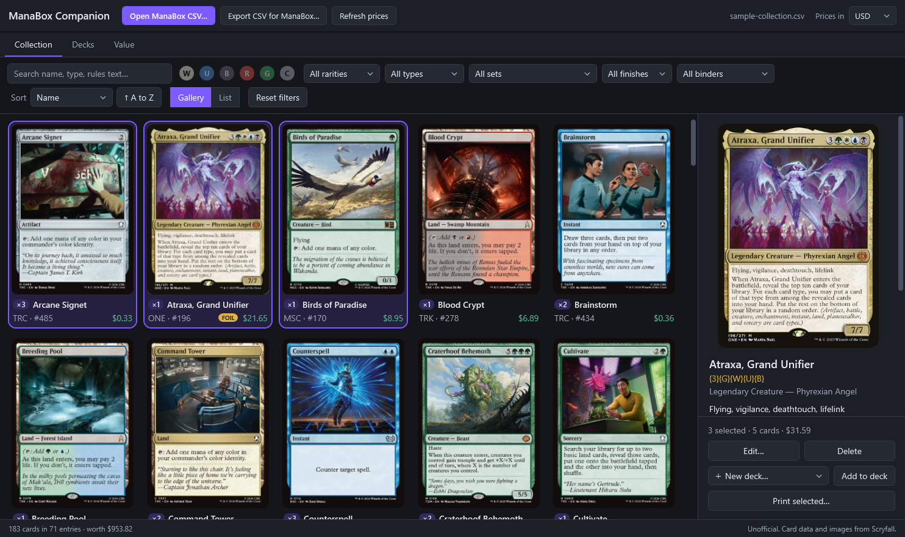
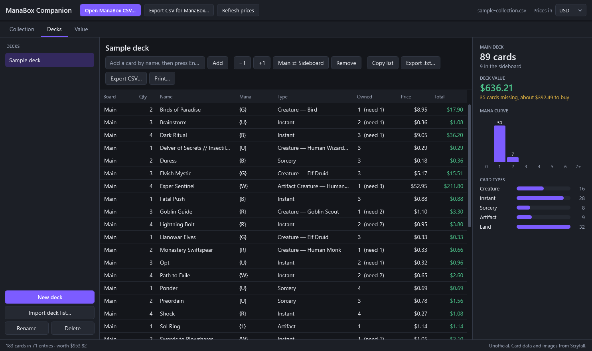

# ManaBox Companion for Windows 10 and 11

Your ManaBox collection on the big screen. Browse, search, bulk-edit and value your Magic: The Gathering cards on your PC, then send the changes back to ManaBox.

<p align="center">
  <a href="https://github.com/Jurajoxx/manabox-windows-10-and-11/releases/latest/download/ManaBoxCompanion.exe">
    
  </a>
  <br>
  <sub>One small .exe. Nothing to install. <a href="https://github.com/Jurajoxx/manabox-windows-10-and-11/releases/latest">All releases</a></sub>
</p>



This is a companion app. It does not run ManaBox itself; it works with the CSV files ManaBox exports and imports. It is unofficial and not affiliated with ManaBox.

## How it works

1. In ManaBox on your phone, export your collection as a **CSV** file.
2. Send the file to your PC (email, cloud drive, USB cable).
3. Open it in ManaBox Companion, or drop it on the window.
4. Edit as much as you like, press **Export CSV for ManaBox…**, and import that file in ManaBox.

Syncing is manual: nothing changes on your phone until you import the exported file there.

## What it does

- **Browse on a big screen.** A gallery of card images or a sortable list, with a detail panel showing rules text, set, finish, condition and prices.
- **Search and filter.** By name, type or rules text, plus colour, rarity, card type, set, finish and binder. The search box understands `t:goblin`, `o:flying`, `s:mh2` and `r:mythic`.
- **Prices.** Current market prices in USD or EUR for every card, with totals for the whole collection, the current filter and the current selection.
- **Bulk editing.** Select many cards (Ctrl+click, Shift+click, Ctrl+A) and change quantity, condition, finish, language, binder or purchase price in one go, or delete them.
- **Deck building.** Create decks from your collection or by card name, with a sideboard, mana curve, card type breakdown, deck value and a list of what you still need to buy. Import and export deck lists as text or CSV.
- **Value tracking.** A snapshot of the collection's value is saved each day you open it, and drawn as a chart. Also shows what you paid versus what the cards are worth now, your most valuable cards, and value by rarity and set.
- **Printable lists.** Print the collection, a filtered view, a selection or a deck as a checklist, or save it as a PDF with "Microsoft Print to PDF".
- **Round-trips cleanly.** Every column of the ManaBox export is kept exactly as it was, including ones the app does not use.



## Getting started

1. Press the download button above and run `ManaBoxCompanion.exe`.
2. Windows may show a blue "Windows protected your PC" box because the app is not code-signed. Choose **More info**, then **Run anyway**.
3. Press **Try the sample collection** to look around, or open your own export.

Requirements: Windows 10 or Windows 11. The app uses the .NET Framework that is already part of Windows, so there is nothing else to install. An internet connection is needed the first time a card is shown; after that, card data and images are cached and the app also works offline.

## Your data

- Your collection file stays on your PC. The only thing sent over the internet is the list of card identifiers the app asks Scryfall about.
- Card data, images, decks and value history are stored in `%LOCALAPPDATA%\ManaBoxCompanion`. Delete that folder to reset the app.
- The app never changes the CSV file you opened. Edits are written only to the file you export.

## Keyboard shortcuts

| Keys | Action |
| --- | --- |
| Ctrl+O | Open a ManaBox CSV |
| Ctrl+S | Export a CSV for ManaBox |
| Ctrl+F | Jump to the search box |
| Ctrl+click, Shift+click | Select several cards |
| Ctrl+A | Select everything shown |
| Double-click | Edit a card |
| Del | Delete the selected cards |
| Esc | Clear the selection |

## Building it yourself

No Visual Studio or .NET SDK is needed. The build script uses the C# compiler that ships with Windows:

```powershell
powershell -ExecutionPolicy Bypass -File build.ps1
```

The result is `dist\ManaBoxCompanion.exe`. To check a build, run the built-in self-test, which drives the real window and dialogs against the sample collection and writes a report:

```powershell
dist\ManaBoxCompanion.exe --open sample\sample-collection.csv --selftest "$env:TEMP\selftest.txt"
```

Pushing a tag such as `v1.0.1` makes GitHub Actions build the app and publish it as a release, which is what the download button points at.

| Path | Contents |
| --- | --- |
| `src/` | C# source and the two XAML files (window layout and theme) |
| `sample/` | A small sample collection in ManaBox's CSV layout |
| `assets/` | Icon, screenshots and the download button |
| `tools/` | Script that regenerates the icon |
| `.github/workflows/` | The release build |

## Credits and legal

Card data, prices and images are provided by [Scryfall](https://scryfall.com). This app is not produced by or endorsed by Scryfall.

ManaBox is the work of its own developers. This project is an independent, unofficial companion and is not affiliated with or endorsed by ManaBox.

Magic: The Gathering, its card names, text and artwork are property of Wizards of the Coast LLC. This app is unofficial Fan Content permitted under the Fan Content Policy. Not approved or endorsed by Wizards. Portions of the materials used are property of Wizards of the Coast. © Wizards of the Coast LLC.
